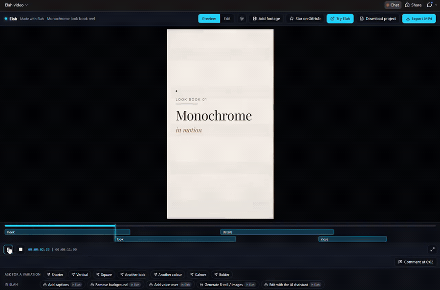

# Elah

**A browser-native, frame-accurate video engine for the web.** One framework-agnostic core — timeline, WebGL2 renderer, media pipeline, MP4 export — that you drive three ways: **embed a real editor** in your app, **generate video from code or an AI**, or **render headless** on a server. Everything runs in the browser: no upload, no account, no key. Any aspect ratio.

[](https://www.npmjs.com/package/@elah/editor)
[](./LICENSE)
[](https://www.npmjs.com/package/@elah/editor)

[**Website**](https://www.elah.dev) · [**Docs**](https://www.elah.dev/docs) · [**Live playground**](https://www.elah.dev/playgrounds) · [**Changelog**](https://www.elah.dev/changelog) · [**Discord**](https://discord.gg/qKJXvc4Pwu)



| You want to… | Use | Live |
|---|---|---|
| Put a video editor in your product | `@elah/editor` | [playground/production](https://www.elah.dev/playground/production) |
| Just the timeline UI | `@elah/timeline` | [playground/timeline](https://www.elah.dev/playground/timeline) |
| Generate video from code or an AI | `@elah/core/spec`, `@elah/core/html` | [samples](./artifact/samples) |
| Render on a server or in CI | `@elah/cli` | — |
| Make a video by chatting with Claude | [the Claude Code plugin](./plugins/elah) | — |

All of them produce the **same `Project` document**, so a video an AI generates opens in the timeline with real keyframes and can be edited by hand.

---

## 1. The editor

```bash
npm install @elah/editor lucide-react
```

```tsx
// All three stylesheets — each package compiles its own, so they do not
// contain each other's classes.
import '@elah/timeline/styles.css'
import '@elah/editor/styles.css'
import '@elah/editor/styles/tokens.css'

import { EditorProvider, Preview, Timeline, AssetPanel, createDefaultDemuxerFactory } from '@elah/editor'

const demuxerFactory = createDefaultDemuxerFactory()

export default function App() {
  return (
    <EditorProvider fps={30}>
      <div className="elah-root" style={{ display: 'flex', height: '100vh' }}>
        <AssetPanel style={{ width: 220 }} />
        <Preview demuxerFactory={demuxerFactory} style={{ height: 480 }} />
        <Timeline style={{ height: 300 }} />
      </div>
    </EditorProvider>
  )
}
```

Drag a file into the asset panel, drop it on the timeline, press **Space**. Theming is the `--elah-*` tokens redefined under `.elah-root`.

Edits go through one funnel, `TimelineEngine`, so undo, history and events come free:

```ts
const track = engine.addTrack('video')
engine.addClip({ trackId: track.id, type: 'video', src: '/clip.mp4', startFrame: 0, durationFrames: 90 })
engine.batch(() => { /* several edits, one undo step */ })
```

Runnable apps: [`examples/minimal`](./examples/minimal) (smallest complete editor), [`examples/react`](./examples/react) (Vite), [`examples/next`](./examples/next) (App Router).

---

## 2. Motion

Keyframes live on the clip as data, so motion serializes, diffs and round-trips like everything else:

```ts
clip.keyframes = {
  channels: {
    opacity: { source: { kind: 'keyframes' }, keys: [
      { id: 'o0', frame: 0,  value: 0, easing: 'cubic-out' },
      { id: 'o1', frame: 10, value: 1, easing: 'linear' },
    ] },
    x: { source: { kind: 'keyframes' }, keys: [/* … */] },
  },
}
```

Every transform channel is keyframeable, with the full ease set (sine through bounce, `steps(n)`, cubic-bezier) and closed-form **springs**, plus hold keys, **stagger** (from start/end/centre/edges/random, or across a grid), **motion paths**, per-unit **text animators**, scramble text, repeat/yoyo, skew, 3D tilt (`rotateX`/`rotateY`), **expressions**, and 36 ready presets.

**Transitions** — 9 kinds, one shader, identical in preview and export:

```
fade · slide · wipe · zoom · spin · whip · glitchCut · warpDissolve · lumaWipe
```

---

## 3. Effects, generators and clip types

**23 GPU effects** in one WebGL2 pipeline shared by preview and export:

```
colorGrade · gaussianBlur · vignette · grain · rgbSplit · letterbox · chromaticAberration
scanlines · bloom · glow · flash · strobe · lightRays · wave · twirl · bulge · fisheye
displace · vhs · crt · pixelate · glitchBlocks · motionBlur
```

**8 generators** that draw their own picture from params and time:

```
particles · energyLines · lightLeak · lensFlare · gradientBackground · counter · barChart · progressBar
```

**Clip types**: `video`, `audio`, `text`, `image`, `shape`, `freehand`, `adjustment`, `generator`, `compound` (a nested project as one clip) and `sequence` (animated image or numbered frames). Plus masks, track mattes, blend modes, per-clip audio (mute, boost, fades, noise reduction), and **Lottie & SVG import** that produces editable clips and keys.

---

## 4. Programmatic video

Write a document, get a real editable project.

**VideoSpec** (`@elah/core/spec`) — seconds-based JSON aimed at models. Problems come back as path-addressed issues instead of throwing, so a generator can correct itself:

```ts
import { buildVideo } from '@elah/core/spec'

const { project, issues } = buildVideo({
  version: 1,
  format: { width: 1920, height: 1080, fps: 30 },
  duration: 6,
  design: { colors: [{ name: 'bg', value: '#0b1020' }, { name: 'ink', value: '#ffffff' }] },
  background: '$bg',
  elements: [
    { id: 'title', kind: 'text', at: 0, duration: 3, text: 'Ship it', font: '$sans', enter: 'blur-in' },
  ],
})
// issues: [{ path: 'elements[0].font', message: '…' }] — never a throw
```

It expands 17 motion components and 6 motion systems. Real inputs to read: [`artifact/samples/`](./artifact/samples) (launch, data story, logo, title card, camera moves, sound cues).

**HTML/CSS scenes** (`@elah/core/html`) — author in ordinary HTML and CSS animation, convert to native clips and keys:

```ts
import { validateScene, sceneToClip } from '@elah/core/html'

validateScene({ html, css })            // refusals name the supported substitute
sceneToClip(measuredScene, { fps: 30 }) // → one compound clip of real keys
```

**`layProject(project, engine)`** drops either onto a live editor as a single undo step. **`@elah/core/ops`** gives an agent 57 typed ops to edit an existing project instead.

These sit on their own subpath entries, off the `@elah/core` root, so an app that never imports them **pays zero bytes** ([`BUNDLE_STRATEGY.md`](./BUNDLE_STRATEGY.md)).

---

## 5. Headless

```jsonc
// spec.json — seconds, assets by path or URL
{
  "fps": 30,
  "assets": { "footage": "./media/clip.mp4" },
  "clips": [
    { "track": "video", "asset": "footage", "start": 0, "duration": 8 },
    { "track": "text", "text": "Hello", "start": 0.5, "duration": 4, "fontSize": 96 }
  ]
}
```

```bash
npx @elah/cli build --spec spec.json --export final.mp4
elah serve --port 8080          # warm-browser HTTP render server; POST /render → MP4
```

`export` runs core's real `exportVideo` in headless Chrome, so CLI output matches editor output by construction. A [`Dockerfile`](./packages/cli/Dockerfile) with Chrome and fonts ships with the package.

---

## 6. From Claude Code

```
/plugin marketplace add elahlabs/elah
/plugin install elah@elah
```

`/elah:motion <brief>` drafts a launch, explainer, chart, recap of pasted notes or vertical reel, then opens it in an artifact to preview, edit and export. `/elah:saas <what your product is for>` scaffolds your own editor app on these packages. See [`plugins/elah`](./plugins/elah).

---

## Packages

| Package | What it is |
|---|---|
| [`@elah/editor`](https://www.npmjs.com/package/@elah/editor) | The React editor SDK, and a barrel re-exporting the three below. **Install this one** unless you want less. |
| [`@elah/timeline`](https://www.npmjs.com/package/@elah/timeline) | Timeline UI: ruler, tracks, clips, playhead, trim, drag |
| [`@elah/react`](https://www.npmjs.com/package/@elah/react) | React bindings: editor context, store hooks, audio hooks |
| [`@elah/core`](https://www.npmjs.com/package/@elah/core) | The engine. No React. Subpaths: `/engine` (browser-free), `/spec`, `/html`, `/ops`, `/icons` |
| [`@elah/cli`](https://www.npmjs.com/package/@elah/cli) | Headless `elah` command — split/trim/build/export/serve |

Every package above is at **1.0.0** and follows semver — a breaking change needs 2.0. The four UI/engine packages release in lockstep; `@elah/cli` keeps its own version line and `cli-v*` tag. The AI-facing subpaths (`/spec`, `/html`, `/ops`, `/icons`) are experimental and may change in a minor, which is why they are off the root. The one exception is `@elah/react-native`, early at 0.x — see [`docs/react-native/`](./docs/react-native/README.md).

Peers: `react`, `react-dom` >= 18; `lucide-react` for the UI packages. Export needs WebCodecs (Chromium).

---

## How it works, in one paragraph

A single immutable `Project` tree owns all timeline data. `TimelineEngine` is the only place mutations happen — every edit is an Immer-backed commit with structural sharing, history, batching and typed events. Time is **integer frames**, never floating-point seconds. A pure `resolveTimeline(frame, project) → Scene` decides what is visible and audible, and is the only thing renderers consume. The shipped renderer is a WebGL2 `GpuRenderer`; video frames come from a push-based WebCodecs pipeline that decodes ahead of the playhead and copies each frame to an `ImageBitmap` so the decoder's output pool never starves. Export reuses the same resolver and the same placement math in a worker, so **preview and export never drift**.

---

## Read next

| | |
|---|---|
| [`docs/ai/ELAH_FOR_AI_AGENTS.md`](./docs/ai/ELAH_FOR_AI_AGENTS.md) | Self-contained SDK guide for AI tools — full API, bundler setup, 12 recipes. No checkout needed. |
| [`AGENTS.md`](./AGENTS.md) | Working inside this repo: layout, commands, the src/dist asymmetry |
| [`ARCHITECTURE.md`](./ARCHITECTURE.md) | The engine in depth |
| [`docs/STATUS.md`](./docs/STATUS.md) · [`ROADMAP.md`](./ROADMAP.md) · [`CURRENT_LIMITATIONS.md`](./CURRENT_LIMITATIONS.md) | Per-feature status, what is next, known gaps |
| [`BUNDLE_STRATEGY.md`](./BUNDLE_STRATEGY.md) · [`PERFORMANCE.md`](./PERFORMANCE.md) | Measured bundle sizes and performance technique |
| [`CONTRIBUTING.md`](./CONTRIBUTING.md) | Conventions and the invariants every renderer change must preserve |

The libraries ship **no telemetry**. Questions: [Discord](https://discord.gg/qKJXvc4Pwu) · [issues](https://github.com/elahlabs/elah/issues) · [paul@elah.dev](mailto:paul@elah.dev).

Apache-2.0. Copyright (c) 2026 Elah Labs Private Limited. See [`LICENSE`](./LICENSE).
